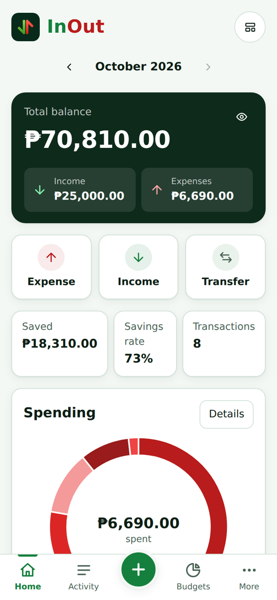
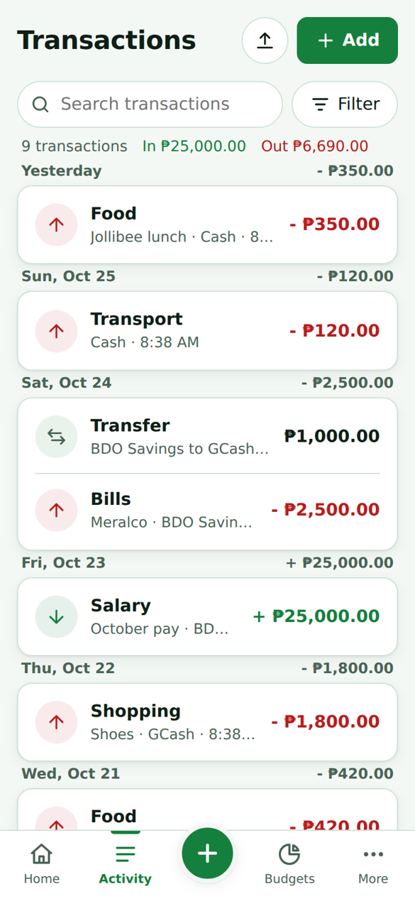
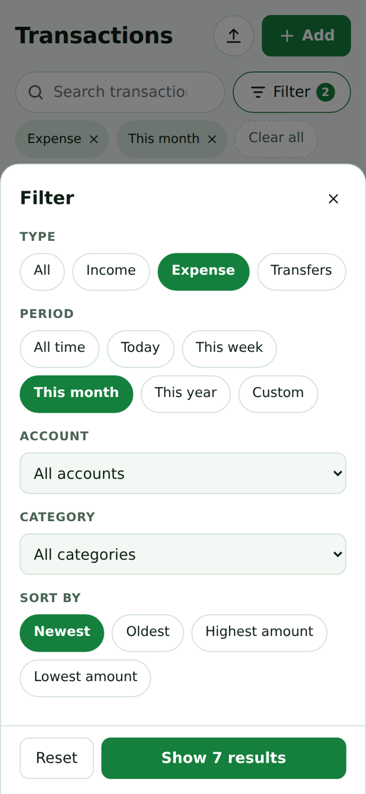
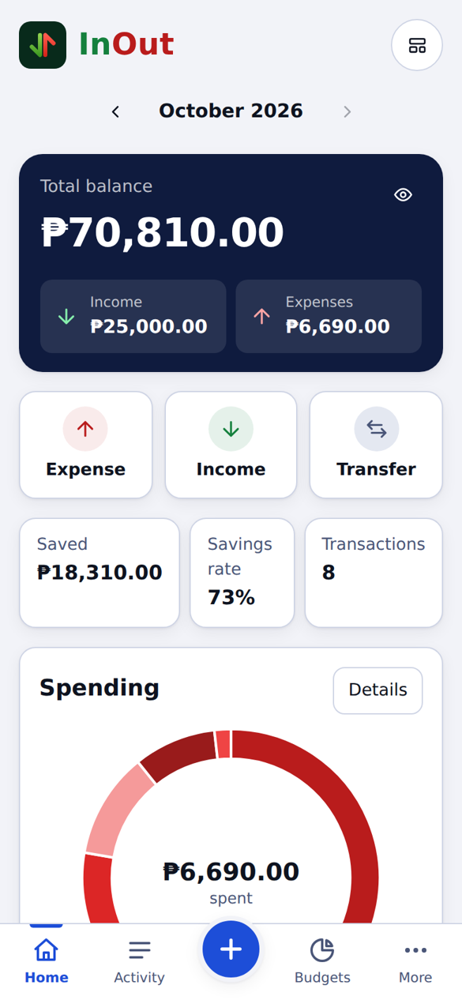
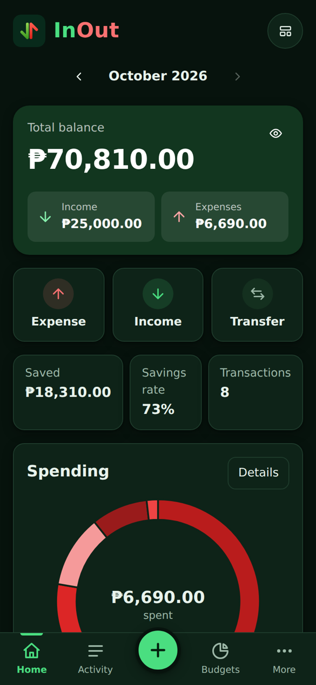

# InOut

A simple money tracker for Android. No account. No internet. Your data stays on your phone.

  
  
  
  
  

*Screenshots use sample data.*

## Download

**[Download the latest APK](../../releases/latest)**

Open the link, then tap the `.apk` file under Assets.

## What you can do

- Track income, expenses and transfers between accounts (cash, bank, e-wallet)
- Search and filter your history
- Set budgets and get alerts before you go over
- Keep track of loans: what you owe and what others owe you
- Add recurring bills and income
- Save toward goals
- See reports and a money health score
- Import transactions from a CSV file
- Make your dashboard your own: choose and reorder cards, pick your own color, light or dark mode
- Lock the app with a PIN
- Back up and restore your data

## Install

1. Download the APK on your phone.
2. Open it. If Android asks, allow installing apps from this source.
3. Tap Install.

Android may show a warning because the app is not from the Play Store. That is normal for apps installed this way.

**Needs Android 7.0 or newer.**

## Update

Download the new APK and install it over the old one. Your data stays.

## Check your download (optional)

Each release lists a SHA-256 code. To check your file, run one of these and compare the result with the code in the release:

- Windows: `certutil -hashfile InOut-1.0.apk SHA256`
- Mac or Linux: `shasum -a 256 InOut-1.0.apk`

If the codes match, the file is the one I published.

## Privacy

- No account and no sign up
- No internet permission, so the app cannot send your data anywhere
- No ads and no tracking
- Everything is stored on your phone only

Because of this, if you uninstall the app or clear its data, your records are gone. Use **Settings > Download backup** now and then.

The PIN keeps a curious person from looking at your money. It does not encrypt your data.

## Help

Found a bug or have an idea? [Open an issue](../../issues).

## License

Copyright (c) 2026 Reynaldo Mirandila Benedito Jr. (Rem). All rights reserved.

You may install and use InOut for yourself. The source code is not public, and you may not copy, change, repackage or sell the app. See [LICENSE](LICENSE).
